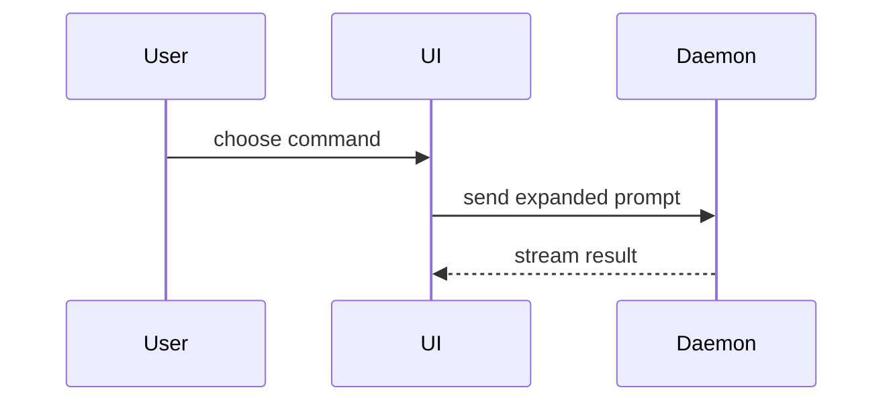

Open a task's pull request only when `"$AGENT_KIT_DIR/bin/task" show` names this skill for your turn: before that, the work hasn't passed review.

The title is as the `git-conventions` skill says (`$AGENT_KIT_DIR/skills/git-conventions/SKILL.md`): `[<task id>] type(scope): summary`.

Use this template for writing the PR body:

```markdown
## Task

- **Task:** `<$AGENT_TASK_FILE>` on `<$AGENT_NOTES_BRANCH>`
- **Review:** `<$AGENT_TASK_NOTES>/REVIEW.md` on `<$AGENT_NOTES_BRANCH>`

- [x] <acceptance criterion, as TASK.md words it>: <how it's met>

## Summary

<diagram, diff-sketch, or tree>

## Evidence

- **Before:** <the test that failed, and its output>
  **After:** <the same test passing, and the project's checks>

## Merge Danger

**Door:** <one-way or two-way>

<optional: description>

**Blast Radius:** <one-word description>

<optional: potential ramifications of merge>
```

## Sections

Skip all preambles and keep prose brief. Use the project's domain language from `GLOSSARY.md`.

### Task

Where the task and its review live, so whoever merges can read them: the paths to `TASK.md` and `REVIEW.md` in the task notes on `$AGENT_NOTES_BRANCH`, with each variable in the template written out as its value. Then every acceptance criterion in `TASK.md`, in its words, each with how it's met: the test, the file or the commit that shows it. A criterion not met is listed unticked, with why.

### Summary

Pick the smallest view that makes the key point clear.

- Show logic or an algorithm as pseudocode:

```text
on(save)
  if content is unchanged
    return cached result
  write new content
  return fresh result
```

- Show runtime control flow as a call tree:

```text
submitForm
  createSession
    persistPrompt
    launchAgent
  navigateToSession
```

- Show UI structure as a component tree, including state and module boundaries that matter:

```text
<SessionPage> (apps/example/src/routes/session.tsx)
  useSessionEvents()
  <SessionToolbar>
    <RunSkillButton> (packages/ui)
```

- Show file responsibility or a broad refactor as a shallow file tree:

```text
src/
├── commands/       # parses user actions
├── sessions/       # owns session state
└── transport/      # sends API requests
```

- Show component interaction, control flow, or data flow with Mermaid:



- Use `diff` when the point is what changes and the surrounding shape already exists. Match the diff shape to the topic.

For a component change:

```diff
 <SessionPage>
   useSessionEvents()
   <SessionToolbar>
+    <RunSkillButton />
   <SessionTimeline>
+    <SkillResultCard />
```

For a file-layout change:

```diff
 src/
 ├── commands/
+│   └── show-me.ts       # expands the slash command
 ├── sessions/
-└── transport.ts
+└── transport/
+    ├── client.ts
+    └── stream.ts
```

For a call-tree or call-stack change:

```diff
 submitForm
   createSession
     persistPrompt
+    expandSkillMention
     launchAgent
-  navigateToSession
+  navigateToSession
+    subscribeToEvents
```

For a state or control-flow change:

```diff
 on(save)
-  write content
+  if content is unchanged
+    return cached result
+  write new content
+  invalidate cache
```

- Show the whole block when most of it is new, when omitted context would hide ownership or order, or when the user needs a copyable target shape:

```ts
function expandSkill(command: string): string {
  const skillName = command.slice(1);
  return `use the ${skillName} skill`;
}
```

#### Guidance

Place each visual next to the short text it supports. Keep only the calls, files, props, states, and boundaries needed to answer the user's current question or the options to resolve the current discussion point.

You may use one of these, you may use several, it is unlikely you will use all of them. Use your judgement and don't overwhelm the user.

### Evidence

Concrete evidence that the change works. Show a before and after.

Screenshots are rarely possible in a sandbox, so the before and after is a test: the exact test that failed before the change and passes after it, using pseudocode, with the output of the project's checks. Add a screenshot only when the change is visual and the environment can take one.

### Merge Danger

Describe whether it's a one-way or two-way door. You can walk back through two-way doors, but not one-way doors. A PR that is cheap to roll back is lower risk. Changes that involve destructive actions or hard-to-reverse decisions are one-way doors.

The blast radius is the potential impact or scope of the changes introduced by this PR. Consider all possibilities. Examples are layout shift, breakages for consumers, mobile responsiveness, etc.
